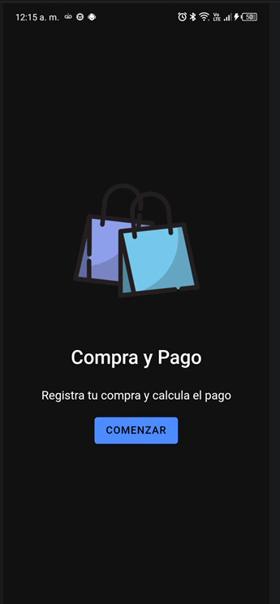
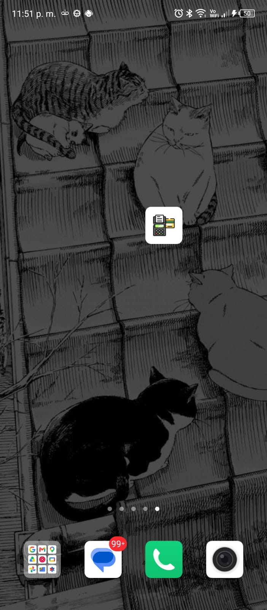
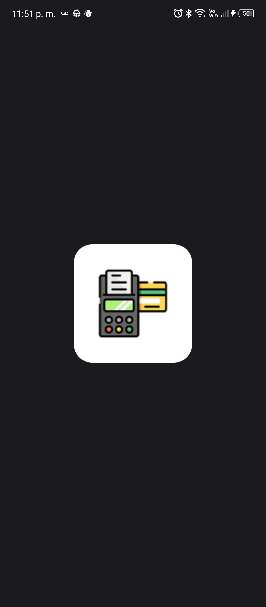
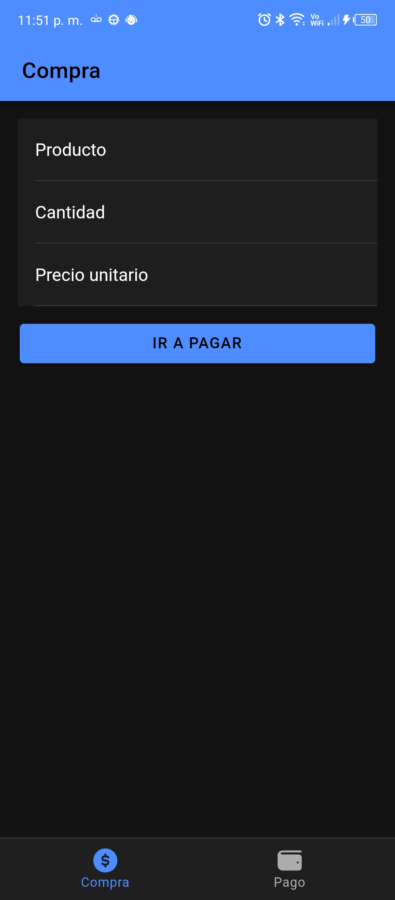
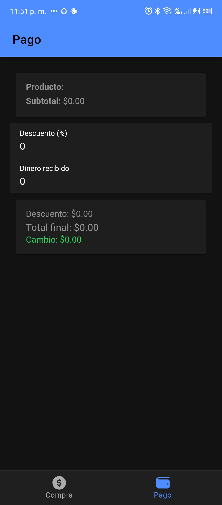

# Compra y Pago

Aplicación móvil desarrollada con **Ionic + Angular + Capacitor** que permite registrar la compra de un producto y calcular el pago, incluyendo descuento, total final y cambio o saldo pendiente.

> **Deber 2** — Desarrollo de aplicaciones móviles
> **Autor:** _JOSUE PATIÑO_

---

## Tabla de contenidos

1. [Descripción](#descripción)
2. [Funcionalidades](#funcionalidades)
3. [Validaciones](#validaciones)
4. [Fórmulas de cálculo](#fórmulas-de-cálculo)
5. [Tecnologías](#tecnologías)
6. [Estructura del proyecto](#estructura-del-proyecto)
7. [Requisitos previos](#requisitos-previos)
8. [Instalación y ejecución](#instalación-y-ejecución)
9. [Ejecutar en Android](#ejecutar-en-android)
10. [Ícono y splash screen](#ícono-y-splash-screen)
11. [Capturas de pantalla y video](#capturas-de-pantalla-y-video)
12. [Problemas frecuentes](#problemas-frecuentes)

---

## Descripción

La aplicación tiene dos pestañas:

- **Compra:** formulario donde se ingresa el nombre del producto, la cantidad y el precio unitario. Al enviarlo, los datos se validan y la app abre automáticamente la pestaña **Pago**.
- **Pago:** muestra el producto y el subtotal recibido, y solicita un descuento porcentual y el dinero entregado por el cliente. Calcula el total final y muestra el **cambio** o el **saldo pendiente**.

Los datos se comparten entre las dos pestañas mediante un servicio de Angular (`CompraService`).

## Funcionalidades

- Registro de la compra con validación de datos en tiempo real.
- Navegación automática de **Compra** a **Pago** al enviar un formulario válido.
- Cálculo automático del descuento, total final y diferencia.
- Mensaje en verde para el **cambio** y en rojo para el **saldo pendiente**.
- Ícono personalizado en cada pestaña.
- Ícono de la aplicación personalizado (generado con `@capacitor/assets`).
- Pantalla de inicio (splash screen) con una imagen propia.

## Validaciones

| Campo | Regla |
|---|---|
| Nombre del producto | Obligatorio (no se aceptan espacios en blanco) |
| Cantidad | Número **entero mayor que 0** |
| Precio unitario | Mayor que 0 |
| Descuento (%) | Entre 0 y 100 |
| Dinero recibido | Mayor o igual a 0 |

Cuando un campo es inválido se muestra un mensaje de error debajo del campo, y el formulario de Compra no permite avanzar a Pago.

## Fórmulas de cálculo

```
subtotal   = cantidad × precio unitario
descuento  = subtotal × (porcentaje / 100)
total      = subtotal − descuento
diferencia = dinero recibido − total
```

- Si `diferencia ≥ 0` → se muestra el **cambio** a devolver.
- Si `diferencia < 0` → se muestra el **saldo pendiente** (el valor absoluto de la diferencia).

**Ejemplo:** 3 unidades a $2.50 con 10 % de descuento y $10.00 recibidos.

| Concepto | Valor |
|---|---|
| Subtotal | $7.50 |
| Descuento (10 %) | $0.75 |
| Total final | $6.75 |
| Cambio | $3.25 |

## Tecnologías

- [Ionic](https://ionicframework.com/) 9
- [Angular](https://angular.dev/) 22 (componentes standalone, formularios reactivos)
- [Capacitor](https://capacitorjs.com/) 8 (Android)
- [@capacitor/assets](https://github.com/ionic-team/capacitor-assets) para generar ícono y splash
- [@capacitor/splash-screen](https://capacitorjs.com/docs/apis/splash-screen)
- TypeScript

## Estructura del proyecto

```
compra-pago/
├── assets/                 # Imágenes fuente para @capacitor/assets
│   ├── icon-only.png
│   ├── icon-foreground.png
│   ├── icon-background.png
│   ├── splash.png
│   └── splash-dark.png
├── android/                # Proyecto nativo de Android (Capacitor)
├── docs/                   # Capturas de pantalla y video de verificación
├── src/
│   ├── app/
│   │   ├── compra.service.ts   # Estado compartido de la compra
│   │   ├── tabs/               # Barra de pestañas
│   │   ├── tab1/               # Pestaña Compra (formulario)
│   │   └── tab2/               # Pestaña Pago (cálculo)
│   └── assets/icon/            # Íconos SVG de las pestañas
├── capacitor.config.ts
├── angular.json
└── package.json
```

## Requisitos previos

- **Node.js** 22 o superior (con `npm`)
- **Android Studio** con:
  - Android SDK Platform **36** (para compilar)
  - Android SDK Build-Tools y Platform-Tools
  - **JDK 21** (incluido como `jbr-21` en Android Studio)
- Un celular Android con depuración USB, o un emulador (se probó con **Android 14, API 34**)

## Instalación y ejecución

1. Clonar el repositorio e instalar dependencias:

   ```bash
   git clone https://github.com/jossuer1/deber-compra-pago
   cd compra-pago
   npm install
   ```

2. Ejecutar en el navegador (modo desarrollo):

   ```bash
   npm start
   ```

   La app se abre en `http://localhost:4200`.

## Ejecutar en Android

1. Compilar la parte web y sincronizarla con el proyecto nativo:

   ```bash
   npm run build
   npx cap sync android
   ```

2. Abrir el proyecto en Android Studio:

   ```bash
   npx cap open android
   ```

   También se puede abrir manualmente la carpeta `android/` con `File > Open`.

3. Esperar a que termine el **Sync de Gradle** y pulsar **Run ▶** con el dispositivo o emulador seleccionado.

> Cada vez que se cambie código de Angular hay que repetir `npm run build` y `npx cap sync android`.

### Probar en un celular real

1. En el celular: `Ajustes > Acerca del teléfono` y tocar 7 veces el **Número de compilación**.
2. Activar **Depuración por USB** en `Opciones de desarrollador`.
3. Conectar el cable USB, aceptar el aviso de depuración y seleccionar el celular en Android Studio.

## Ícono y splash screen

El ícono de la aplicación y el splash screen se generan con **`@capacitor/assets`** a partir de las imágenes de la carpeta `assets/`:

| Archivo | Tamaño | Uso |
|---|---|---|
| `icon-only.png` | 1024×1024 | Ícono principal |
| `icon-foreground.png` | 1024×1024 | Primer plano del ícono adaptable de Android |
| `icon-background.png` | 1024×1024 | Fondo del ícono adaptable |
| `splash.png` | 2732×2732 | Pantalla de inicio (modo claro) |
| `splash-dark.png` | 2732×2732 | Pantalla de inicio (modo oscuro) |

Para regenerar los recursos de Android:

```bash
npx capacitor-assets generate --android --iconBackgroundColor "#ffffff" --splashBackgroundColor "#ffffff"
npm run build
npx cap sync android
```

La duración del splash se configura en `capacitor.config.ts`:

```ts
plugins: {
  SplashScreen: {
    launchShowDuration: 3000,
    backgroundColor: '#ffffff',
    androidScaleType: 'CENTER_CROP',
    showSpinner: false,
  },
},
```

Los íconos de las pestañas **Compra** y **Pago** son SVG personalizados guardados en `src/assets/icon/` (`compra.svg` y `pago.svg`).

## Capturas de pantalla y video

> Las imágenes están en la carpeta [`docs/`](./docs). Se tomaron en un celular con **Android 13**.

### Pantalla de inicio



### Ícono de la aplicación

_Ícono personalizado en el menú de aplicaciones del celular._

<!-- Reemplaza el nombre del archivo por el tuyo -->


### Splash screen

_Pantalla de inicio que se muestra al abrir la aplicación._



### Pestaña Compra

_Formulario con los campos producto, cantidad y precio unitario._




### Pestaña Pago

_Subtotal, descuento, total final y cambio o saldo pendiente._



## Problemas frecuentes

| Problema | Solución |
|---|---|
| Error de Gradle: `InternalProblems ... removed in Gradle 9.6.0` | En `android/gradle/wrapper/gradle-wrapper.properties` usar `gradle-8.14.3-bin.zip`. No aceptar la actualización automática de Gradle. |
| La app abre en blanco en el celular | Ejecutar `npm run build` y `npx cap sync android` antes de correr. |
| El ícono o el splash no cambian | Ejecutar `npx capacitor-assets generate --android`, hacer `Build > Clean Project` y **desinstalar la app** del celular antes de volver a instalarla. |
| `Failed to find target with hash string 'android-36'` | Instalar **Android SDK Platform 36** desde el SDK Manager. |
| El celular no aparece en Android Studio | Revisar el cable (debe transmitir datos), la depuración USB y aceptar el aviso en el celular. |

## Autor

**JOSUE PATIÑO** — Deber 2
